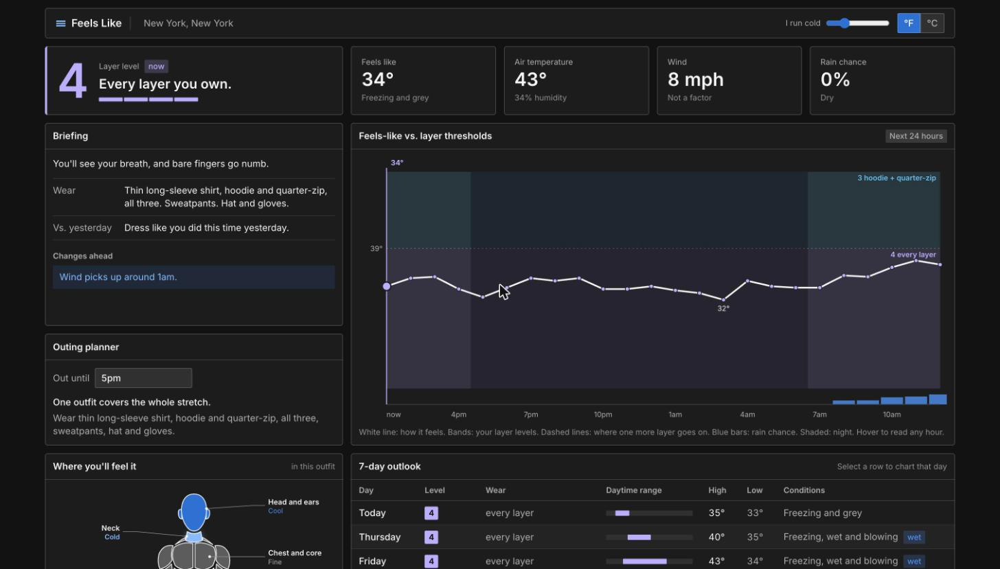

# feels-weather

**I HATE THE COLD.**

I don't function well in it, and I never know what to wear. Weather apps give me numbers; numbers don't tell me how it's going to feel. So I built this. It exists for one reason: to help me not get sick.



## What it does

It looks at the forecast and answers one question: how many layers do I need?

- **Layer level, 1 to 4.** One big number, in my own clothes: long-sleeve, hoodie, quarter-zip, everything.
- **Feels-like chart.** The next 24 hours drawn over the bands where each layer goes on, so I can see when it gets worse.
- **Body map.** Which parts of me will be cold in that outfit (hands, ears, feet) and what to do about it.
- **Briefing.** What my body will notice, what to wear, what to take, and how it compares with yesterday.
- **7-day outlook.** A level for every day this week.
- **Nearby grid.** How it feels in the area around me.
- **Next nice day.** A countdown to the next warm, dry, partly sunny stretch when I can be outside without being cold, with 16 days of peaks drawn against the warm line.
- **Outing planner.** Dresses me for the coldest part of the time I'll be out.
- **Calibration.** "Too cold / just right / too warm" buttons and an "I run cold" slider that shift every threshold.

## Run it

```bash
npm install
npm run dev
```

Open http://localhost:3000 and allow location, or search for a city.

## Make it yours

The clothes are mine. Change the `WARDROBE` block in `lib/feel.ts` to match what's in your closet.

## Built with

Next.js, Tailwind CSS, and forecast data from [Open-Meteo](https://open-meteo.com) (free, no API key).
